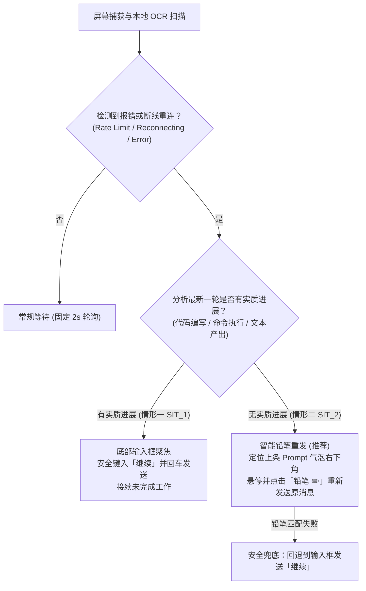

# Codex Auto-Retry V2 (Codex & ChatGPT 智能断线重试助手)

[](https://www.python.org/downloads/)
[](https://opensource.org/licenses/MIT)
[](tests/)
[](https://www.microsoft.com/windows)

专为 Windows 环境下使用 **Codex 桌面端 / ChatGPT 桌面客户端**（以及社区常称的 **A站** / AI 编程与长链路对话场景）量身打造的**全自动断线重连与智能重试助手**。

---

## 📌 为什么需要它？

在使用 Codex 或 ChatGPT 客户端进行深度编程、大规模代码重构或长任务挂机处理时，常因网络抖动、代理波动或服务端限流而频繁中断：
- 屏幕突然弹出 **「正在重新连接 5/5」**、**「Failed to fetch」** 或 **「Rate limit exceeded (429)」**；
- 任务卡死在半途中，必须人工切换窗口点击重试或输入「继续」；
- 如果盲目在底部一直输入「继续」，在没有进展的情况下会导致**上下文被无意义的重试污染**，严重影响模型对后续任务的理解。

**Codex Auto-Retry V2** 通过本地 OCR 屏幕感知与状态机分析，提供**全自动、防干扰、精准区分场景**的无感重试体验。

---

## 🎯 核心机制：精准双分支重试

本工具不会机械盲目地敲回车，而是根据模型当前执行的**实际进展（Progress）**，自动分流执行两种不同的恢复动作：



### 1. 情形一（有进展）：底部输入框发送「继续」
- **判定准则**：上一轮指令后，模型已输出了实质代码更改、运行了命令（`Ran command` / `已运行命令`）或输出了有效回答，但中途中断。
- **执行动作**：自动激活目标窗口，定位底部输入框，安全注入「继续」并模拟回车与发送按键，顺畅承接后续任务。

### 2. 情形二（无进展）：智能铅笔编辑重发（零污染上下文）
- **判定准则**：上一轮指令之后，中间只有「正在重新连接 5/5」或报错卡片，**无任何代码产出或实质进展**。
- **执行动作**：
  1. 光标自动移动到上一个用户提问气泡的右下角触发悬停；
  2. 基于模板匹配自动寻找「铅笔（编辑 ✏️）」图标并点击；
  3. 弹出原消息编辑框后，自动点击「发送」重新提交；
  4. **完全无需、也不会在输入框多发废话**，保持会话上下文干净纯粹。

---

## 🛡️ 安全与工程特性

- **100% 本地与隐私安全**：基于 Windows 原生 Win32 GDI 截图与本地 [RapidOCR](https://github.com/RapidAI/RapidOCR) (ONNX Runtime)，完全离线推理，绝不上报屏幕、文本或 Token，无任何外网传输。
- **零人工干扰设计**：
  - **用户动作避让**：实时监听鼠标与键盘状态（`user_input_active`），若检测到用户正在输入或操作桌面，立即放弃本轮动作，绝不抢夺焦点；
  - **光标现场还原**：触发点击前记录当前鼠标位置，操作完成后毫秒级将光标还原回原位；
  - **草稿保护**：若输入框中已有用户未发送的草稿，绝不自动覆盖或提交。
- **贴底与防死锁**：
  - 自动检测并滚轮平滑贴底，防止因浏览历史记录误将旧报错当成新报错；
  - 固定 2 秒高效重试（`RETRY_COOLDOWN = 2.0s`），移除冗长繁琐的指数级退避；
  - 智能过滤报错卡片内自带的「继续/重试」CTA 按钮，避免将系统卡片识别为用户新提问而陷入循环。

---

## 🤖 对 AI Agent 友好与二次微调 (Agent-First)

本项目具备极高的代码可读性与模块化设计：
- **解耦架构**：配置集中在 `app_config.py`，执行状态机在 `codex_auto_retry_v2.py`；
- **全套 Mock 回归测试**：自带 70 项离线 Pytest 单元测试（完全 Mock 桌面输入 API，不会在测试时乱动屏幕），确保任何改动都能即刻验证。

### 💡 给开发者的建议：直接让 Agent 帮你定制！
如果你的使用场景与默认配置略有不同，**完全不需要自己一行行读代码，直接把本仓库代码投喂给你的 AI Agent（如 Claude Code、Codex、Antigravity、Cursor、Windsurf 等）**，让 Agent 帮你调整：

| 你的定制需求 | 提示词参考（可直接发给 Agent） |
|---|---|
| **改动目标窗口** | *“请帮我在 `app_config.py` 中修改 `TARGET_PROCESSES`，添加我的自定义客户端进程名 `my_client.exe`。”* |
| **新增报错识别词** | *“我们在特定代理下会报 `Connection reset by peer`，请帮我在配置项中增加关键词识别，并补充对应的单元测试。”* |
| **高分屏/多屏适配** | *“我的分辨率缩放比例是 175%，铅笔图标检测阈值需要调整，请根据 `pencil_template.png` 优化模板匹配容差。”* |
| **移植到其他工具** | *“请参考这个仓库的状态机、Win32 窗口枚举与 OCR 分支判定架构，帮我为另外一款 WebUI/客户端编写一套自动重试守护脚本。”* |

---

## 🚀 快速上手

### 1. 环境准备
- 操作系统：Windows 10 / Windows 11
- Python 版本：Python 3.10+ (推荐 Python 3.12)
- 安装依赖：
  ```bash
  pip install -r requirements.txt
  ```

### 2. 启动方式
仓库内已提供开箱即用的批处理脚本：

| 启动方式 | 文件 | 说明 |
|---|---|---|
| **前台运行（推荐）** | `start.bat` | 双击运行，带独立控制台窗口，方便实时观察状态与 OCR 日志 |
| **后台静默守护** | `start_background.vbs` | 双击运行，无黑框后台常驻，日志写入 `logs\auto-retry.log` |
| **优雅停止** | `stop.bat` | 停止当前目录下正在运行的监控进程，不影响其他程序 |
| **运行离线回归测试** | `run_tests.bat` | 一键运行 70 项离线测试，校验核心逻辑是否完好 |

### 3. 常用命令行参数
你也可以直接通过 Python 命令行调用：
```bash
# 启动监控服务
python codex_auto_retry_v2.py

# 启动前自检（检查依赖、OCR 引擎和配置一致性）
python codex_auto_retry_v2.py --check

# 单次探测模式（只扫描一轮当前窗口，输出分析结果后退出）
python codex_auto_retry_v2.py --once

# 演练模式（Dry Run，仅识别与判定状态，不执行任何鼠标键盘点击或文本发送）
python codex_auto_retry_v2.py --dry-run --once

# 停止后台运行的实例
python codex_auto_retry_v2.py --stop
```

---

## ⚙️ 关键配置说明 (`app_config.py`)

如需调整监控细节，可直接编辑 `app_config.py`：

| 配置项 | 默认值 | 说明 |
|---|---|---|
| `poll_interval` | `2.0` | 扫描检测轮询间隔（秒） |
| `retry_cooldown` | `2.0` | 重试固定冷却时长（秒） |
| `post_action_cooldown` | `2.0` | 每次动作触发后的防抖保护时长（秒） |
| `target_processes` | `("chatgpt.exe", "codex.exe")` | 监控的目标进程名称列表 |
| `exclude_processes` | `("antigravity.exe", ...)` | 严禁误触的黑名单进程列表 |
| `sit2_prefer_edit_resend` | `True` | 情形二（无进展）是否优先使用铅笔编辑重新提交 |
| `sit2_fallback_to_composer` | `True` | 铅笔未匹配到时，是否自动回退到底部输入框发送「继续」 |
| `auto_send_text` | `"继续"` | 情形一自动发送的接续文字 |
| `auto_scroll_enabled` | `True` | 是否在分析前自动滚动贴底 |
| `pencil_match_threshold` | `0.65` | 铅笔图标模板匹配置信度阈值 |

---

## 📂 仓库结构

```text
codex-auto-retry-v2/
├── app_config.py               # 集中配置管理与合法性校验
├── codex_auto_retry_v2.py      # 主程序：Win32 API / OCR 识别 / 状态机 / 动作执行
├── pencil_template.png         # 消息编辑“铅笔”图标的匹配模板
├── requirements.txt            # 依赖声明（运行依赖 + 测试依赖）
├── start.bat                   # 前台启动脚本
├── start_background.vbs        # 后台静默启动脚本
├── stop.bat                    # 进程停止脚本
├── run_tests.bat               # 测试运行脚本
├── README.md                   # 项目使用与二次开发指南
├── LICENSE                     # MIT 开源协议
└── tests/                      # 离线回归测试套件（70 项全绿）
    ├── test_auto_retry.py      # 状态机、分支策略与 API 模拟测试
    └── fixtures/
        └── screenshot_no_progress.json  # 真实断线场景数据样例
```

---

## ❓ 常见问题 (FAQ)

### Q: 启动提示 `ImportError: 未检测到 rapidocr_onnxruntime`？
请确保在对应 Python 环境下安装了依赖包：
```bash
pip install -r requirements.txt
```
如果下载慢，可使用国内镜像源：
```bash
pip install -r requirements.txt -i https://pypi.tuna.tsinghua.edu.cn/simple
```

### Q: 运行测试会不会乱动我的鼠标或向窗口发消息？
绝对不会。`tests/test_auto_retry.py` 中通过 `no_live_inputs` fixture 对所有 Win32 鼠标键盘和输入 API 做了强制拦截（只要调用真实 API 就会立即抛错报错），70 项测试 100% 在内存中离线完成。

### Q: 多开窗口时如何判定？
程序优先选取当前最前端激活的目标窗口；若目标窗口处于后台，可通过配置进行安全聚焦，确保只重试当前活跃的工作任务。

---

## 📄 开源协议

本项目采用 [MIT License](LICENSE) 开源协议。欢迎提交 Issue、PR 或使用 AI Agent 基于本项目二次开发！
